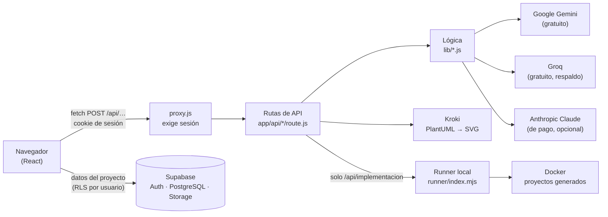
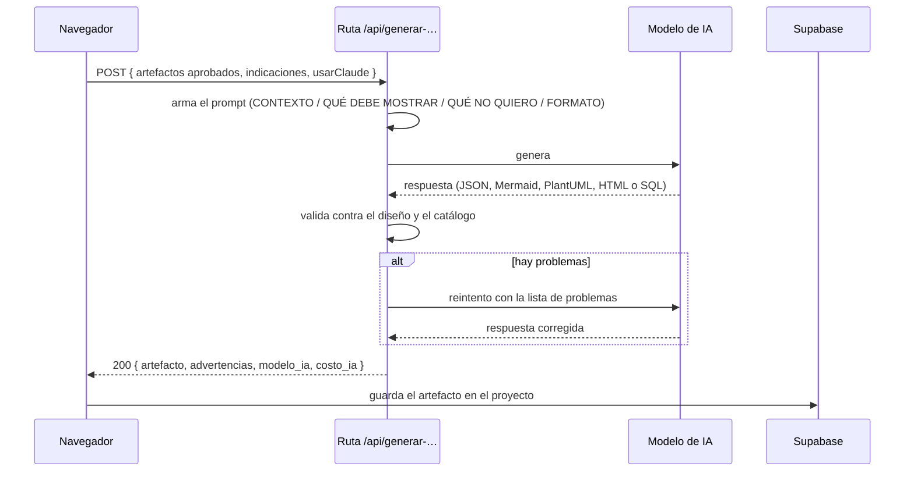

# Arquitectura y comunicación

I-CASE Tool es una aplicación **Next.js 16** (App Router). La interfaz y la API viven en el mismo proyecto: cada artefacto se genera llamando a una **ruta de API** propia (`/api/generar-…`), que arma el prompt, llama al modelo de IA, **valida** la respuesta y la devuelve al navegador. El navegador guarda el resultado en **Supabase** con la sesión del usuario.

## Componentes

| Componente | Dónde | Qué hace |
|---|---|---|
| Interfaz | `app/(app)/…` | Páginas del proyecto, fases, fichas y explorador de archivos |
| Control de acceso | `proxy.js` | Toda ruta, incluida `/api/*`, exige sesión de Supabase; sin sesión redirige a `/login` (307). `/docs` es pública |
| Rutas de API | `app/api/*/route.js` | Un endpoint por paso. Reciben JSON y devuelven JSON |
| Lógica de IA | `lib/gemini.js`, `lib/groq.js`, `lib/claude.js` | Un punto único (`generarContenido`) decide qué modelo responde |
| Lógica de cada paso | `lib/stack.js`, `lib/estructura.js`, `lib/bd.js`… | Prompts, validación determinista y reintento |
| Persistencia | Supabase | Usuarios (Auth), proyectos y artefactos (PostgreSQL con RLS), archivos (Storage) |
| Runner | `runner/index.mjs` | Proceso local que ejecuta Docker: levanta y prueba los proyectos generados. Escucha solo en `127.0.0.1` y exige un token |

## Flujo de una generación

Las rutas **no guardan**: devuelven el artefacto y el navegador lo guarda en `proyectos` (una columna por paso) con la sesión del usuario. Así las políticas RLS de Supabase garantizan que cada usuario solo modifique sus proyectos.

## Tiempos

Las rutas de generación tienen `maxDuration = 300` segundos. La cadena de modelos usa ese presupuesto: si un modelo no empieza a responder en 45 segundos, se pasa al siguiente. Los pasos largos (prototipo y base de datos) se piden **por partes**, una pantalla o un archivo por petición, para no superar ese límite.
