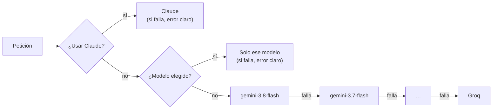

# Integraciones externas

## Modelos de IA

Todas las llamadas pasan por una sola función, `generarContenido` (`lib/gemini.js`), que decide qué modelo responde según la preferencia del usuario.

| Proveedor | Cómo se integra | Modelos | Costo |
|---|---|---|---|
| **Google Gemini** | SDK `@google/genai`, `generateContentStream` (streaming) | `gemini-3.8-flash`, `gemini-3.7-flash`, `gemini-3.6-flash`, `gemini-3.5-flash`, `gemini-3-flash-preview` (configurable con `GEMINI_MODELOS`) | Gratuito |
| **Groq** | API compatible con OpenAI (`https://api.groq.com/openai/v1/chat/completions`) | `openai/gpt-oss-120b`, `qwen/qwen3.8-27b`, `openai/gpt-oss-20b` (configurable con `GROQ_MODELOS`) | Gratuito |
| **Anthropic Claude** | SDK `@anthropic-ai/sdk` | `claude-sonnet-5` (configurable con `CLAUDE_MODELO`) | De pago: $2 por millón de tokens de entrada y $10 por millón de salida |

### Cadena automática

- Un modelo **sin cuota** (HTTP 429 `RESOURCE_EXHAUSTED`) queda en pausa el tiempo que indica Google, con un máximo de 12 horas.
- Un modelo que **tardó en fallar** queda en pausa 2 minutos, para no esperarlo en cada llamada.
- **Respuestas cortadas o 503:** el log las muestra como *"Google cortó la respuesta (saturación)"* o *"Google está saturado (503)"*, y se pasa al siguiente modelo.
- **Groq de respaldo:** no sirve para los pasos grandes de Diseño e Implementación, porque el prompt supera el límite de tokens por minuto de su plan gratuito.

## Kroki (diagramas PlantUML)

El diagrama de sistemas es **PlantUML** (formato WBS). El navegador lo envía a `/api/renderizar-diagrama`, que lo dibuja en `KROKI_URL` (ej. `https://kroki.io`) y devuelve el **SVG**. El SVG se guarda junto al código, en `diagramas_svg`, para no depender de Kroki al volver a abrir el proyecto. Los diagramas Mermaid los dibuja el navegador.

## Supabase

| Servicio | Uso |
|---|---|
| Auth | Registro, inicio de sesión y sesión por cookie (`@supabase/ssr`) |
| PostgreSQL | Tabla `proyectos` (una columna por artefacto) y `archivos_proyecto` (código generado). RLS: cada usuario solo ve y modifica lo suyo |
| Storage | Documentos e imágenes del proyecto, logos y capturas de referencia del prototipo |

## Runner y Docker (Implementación)

`/api/implementacion` es el único puente con el **runner** (`runner/index.mjs`), un proceso local que ejecuta Docker:

| Runner | Qué hace |
|---|---|
| `GET /salud` | Comprueba que está encendido |
| `POST /proyectos/{id}/sincronizar` | Escribe los archivos del proyecto en su carpeta de trabajo |
| `POST /proyectos/{id}/levantar` | `docker compose up` del proyecto |
| `GET /proyectos/{id}/estado` | Servicios, salud y puertos |
| `GET /proyectos/{id}/logs` | Últimas líneas de log |
| `POST /proyectos/{id}/detener` | Apaga los contenedores |
| `POST /proyectos/{id}/eliminar` | Borra contenedores, volúmenes, imágenes y carpeta |
| `POST /proyectos/{id}/probarbd` | Aplica la base desde cero en un proyecto aparte y devuelve tablas, RLS, filas y usuarios |

Todas las peticiones llevan `Authorization: Bearer <RUNNER_TOKEN>`. El runner escucha solo en `127.0.0.1`.

## Servicios de los proyectos generados

Los servicios externos que pide el diseño de un proyecto (Google Maps, Firebase Cloud Messaging…) no los usa I-CASE Tool: los usa el **proyecto generado**, con sus propias claves en su `.env`.
