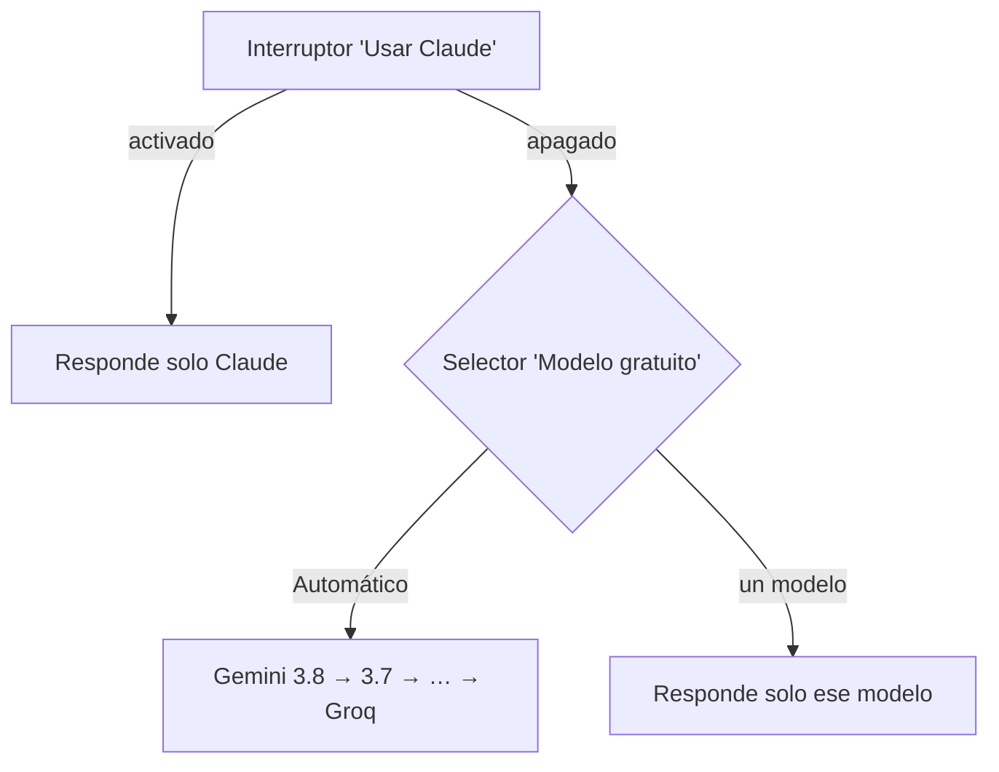

# Componente de IA

## Principio: la IA propone, el código valida

Cada paso combina IA con **validación determinista**:

1. Un **prompt** con estructura fija le pide a la IA el artefacto y le da solo el contexto que necesita: los artefactos aprobados de los pasos anteriores.
2. El **código revisa** la respuesta contra el diseño. Ejemplos: que cada requerimiento tenga su caso de uso, que cada entidad tenga clave primaria, que cada pantalla del prototipo tenga su página, que cada tabla del ER exista en la base.
3. Si hay problemas, la IA recibe la lista y hace **un reintento**.
4. Lo que quede sin resolver se muestra en **"Revisar antes de aprobar"**. La persona decide.

Así la calidad no depende solo del modelo: las reglas importantes las comprueba el código.

## Modelos y versiones

| Modelo | Proveedor | Versión | Cuándo responde | Costo |
|---|---|---|---|---|
| Gemini 3.8 Flash | Google | `gemini-3.8-flash` | Primero en modo automático | Gratuito |
| Gemini 3.7 / 3.6 / 3.5 Flash, 3 Flash Preview | Google | `gemini-3.7-flash`… | Si el anterior falla o está sin cuota | Gratuito |
| GPT-OSS 120B / 20B, Qwen 3.8 27B | Groq | `openai/gpt-oss-120b`, `openai/gpt-oss-20b`, `qwen/qwen3.8-27b` | Último respaldo; o si el usuario lo elige | Gratuito |
| Claude Sonnet 5 | Anthropic | `claude-sonnet-5` | Solo con **Usar Claude** activado | De pago ($2 y $10 por millón de tokens de entrada y salida) |

Los Gemini Pro no se usan: el plan gratuito no tiene cuota para ellos.

## Selección del modelo

- **Automático:** prueba los modelos en orden. Si uno no empieza a responder en 45 s, falla o está sin cuota, pasa al siguiente. Los que se quedaron sin cuota quedan en pausa el tiempo que indica el proveedor.
- **Modelo elegido:** responde solo ese, con más tiempo para empezar. Si falla, el error dice por qué. Conviene usar un solo modelo para todos los archivos de un mismo paso, como la base de datos, para mantener las convenciones.
- **Claude:** se avisa el costo estimado antes de generar los pasos grandes, y la barra lateral lleva la cuenta de lo gastado.

## Generación por partes

Los pasos grandes no se piden de una vez: así no se corta la respuesta y no se pierde lo ya pagado.

- **Prototipo:** una petición por pantalla. Cada una se guarda apenas llega.
- **Estructura de carpetas:** una generación por pieza del stack (web, móvil, base), en paralelo.
- **Base de datos:** un archivo SQL por petición, en orden. Cada uno recibe el código de los anteriores.

## Qué modelo generó cada artefacto

Cada paso guarda el modelo que lo generó (`fases_aprobadas.modelos`) y lo muestra junto a su título.
