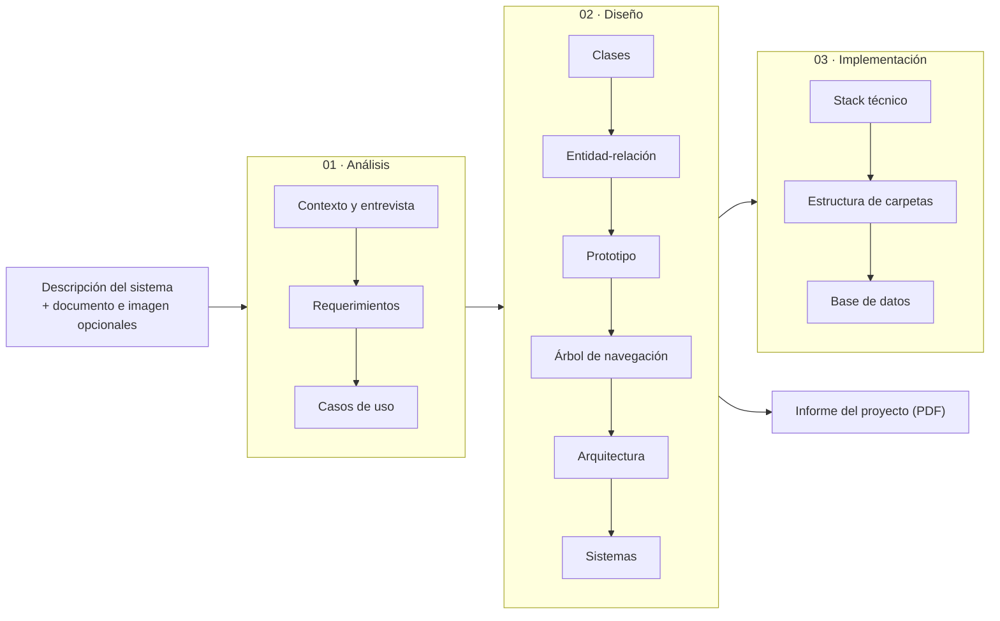

# Documentación de I-CASE Tool

**I-CASE Tool** es una herramienta CASE (*Computer-Aided Software Engineering*) que usa inteligencia artificial para generar los artefactos de cada fase del desarrollo de software. A partir de la descripción de un sistema, produce y deja revisar los requerimientos, los diagramas UML, el modelo de datos, el prototipo de pantallas, la arquitectura y, en la fase de Implementación, el stack técnico, la estructura de carpetas y la base de datos probada en contenedores.

La IA propone y la persona decide: cada artefacto se revisa, se edita y se aprueba antes de pasar al siguiente.

## Por dónde empezar

| Necesito… | Página |
|---|---|
| Usar la herramienta por primera vez | [Primeros pasos](./manual/primeros-pasos) |
| Entender cómo avanza un proyecto de fase en fase | [Flujo de trabajo](./manual/flujo-de-trabajo) |
| Ver un proyecto real de principio a fin | [Caso de estudio: Cuerpo de Bomberos](./manual/caso-de-estudio) |
| Escribir mejores descripciones e instrucciones para la IA | [Cómo escribir buenas entradas](./manual/buenas-entradas) |
| Resolver un problema | [Errores comunes](./manual/errores-comunes) |
| Integrar o revisar la API | [Arquitectura y comunicación](./api/arquitectura) y [Referencia OpenAPI](/api/referencia) |
| Conocer los modelos de IA y los prompts | [Componente de IA](./ia/funcionamiento) |
| Instalar, ejecutar o contribuir | [Instalación](./desarrolladores/instalacion) |

## Fases y artefactos

| Fase | Artefacto | Formato |
|---|---|---|
| Análisis | Preguntas de entrevista | Texto |
| Análisis | Requerimientos funcionales y no funcionales (ISO/IEC 25010), actores | JSON, mostrado como fichas |
| Análisis | Diagrama de casos de uso | Mermaid |
| Diseño | Diagrama de clases | Mermaid |
| Diseño | Diagrama entidad-relación | Mermaid |
| Diseño | Prototipo de pantallas (web y móvil) | HTML |
| Diseño | Árbol de navegación | Mermaid |
| Diseño | Diagrama de arquitectura | Mermaid |
| Diseño | Diagrama de sistemas | PlantUML (WBS) |
| Diseño | Informe del proyecto | PDF (desde el navegador) |
| Implementación | Stack técnico (piezas, contenedores, librerías) | JSON, mostrado como ficha |
| Implementación | Estructura de carpetas (archivos planificados) | JSON, mostrado como ficha |
| Implementación | Base de datos (migraciones y datos de prueba) | SQL, probado en Docker |

## Estado y alcance

- **Implementado y probado:**
  - las fases de **Análisis** y **Diseño** completas;
  - el informe en PDF;
  - en **Implementación**, los pasos *Stack técnico*, *Estructura de carpetas* y *Base de datos*. La base se prueba en contenedores Docker.
- **En construcción:** *Contrato / API*, *Backend*, *Web*, *Móvil* y el cierre de la Implementación (ver [Despliegue y estado del proyecto](./desarrolladores/despliegue)).
- **Requisito de la fase de Implementación:** la ejecución en contenedores (levantar el proyecto generado o probar su base) funciona con I-CASE Tool en local, con Docker Desktop. La versión publicada genera los artefactos, pero no ejecuta contenedores.

## Correspondencia con el punto 1 del taller

| Entregable pedido | Dónde está |
|---|---|
| Herramienta de documentación y su justificación | [Por qué Docusaurus](./desarrolladores/herramienta-de-documentacion) |
| **Documentación de usuario**: propósito, roles, acceso, funcionalidades, flujo por fases, generar/revisar/editar/exportar, capturas, caso de estudio, buenas entradas, errores comunes | Sección **Manual de usuario** |
| **Documentación de API**: endpoints, método, parámetros, respuestas, códigos, ejemplos, autenticación, claves, límites, errores, integraciones externas | Sección **API** y [Referencia OpenAPI](/api/referencia) |
| **Ingeniería de prompts y componente de IA**: por fase, artefacto, modelo y versión, plantilla de prompt, entrada y salida | Sección **IA y prompts** |
| **Documentación para desarrolladores en GitHub**: `README.md`, `CONTRIBUTING.md`, `CODE_OF_CONDUCT.md`, `LICENSE`, `CHANGELOG.md`, `SECURITY.md` y la carpeta de documentación técnica (`docs-site/`) | Repositorio y sección **Desarrolladores**, que incluye el [plan de implementación](./desarrolladores/plan-implementacion) |

## Evidencias

Las capturas de pantalla de este manual son de la aplicación real. Donde todavía falta una, la página lo indica con un recuadro **"Captura pendiente"** y el nombre del archivo que la reemplazará. No se usan capturas simuladas.
