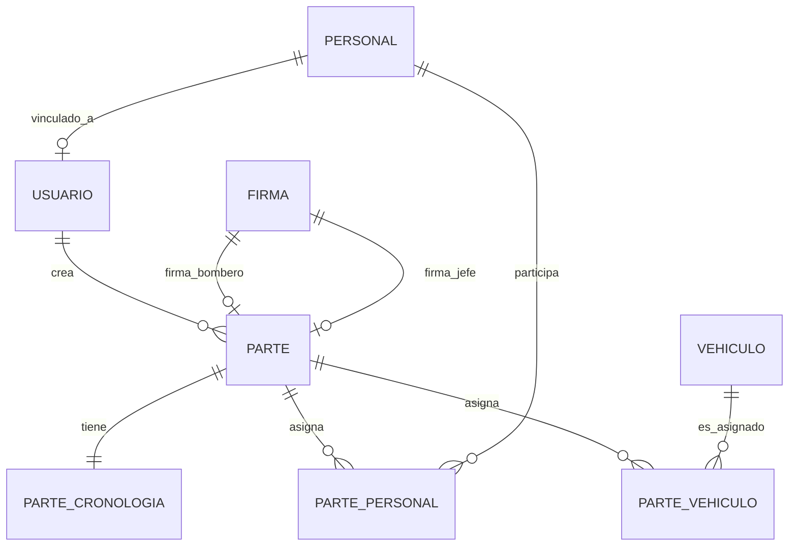

# Caso de estudio: Cuerpo de Bomberos de Baños de Agua Santa

Este proyecto real se usó para construir y probar I-CASE Tool. Muestra el recorrido completo y los números que se obtuvieron.

## La entrada

**Descripción** (resumen): una aplicación web y móvil para el Cuerpo de Bomberos. La parte **web** controla y monitorea: emergencias y sus *partes* de cinco tipos (prehospitalaria, contra incendios, rescates, operativos programados y trabajos varios), bitácoras de guardia, personal, vehículos y usuarios. La parte **móvil** la usan los bomberos en campo, incluso sin conexión.

**Contexto completado:** problema actual (partes en papel), usuarios (Bombero, Jefe de guardia, Administrador), plataformas Web y Móvil, tecnologías ya decididas (Next.js, Flutter y Supabase) y atributos de calidad (seguridad, disponibilidad, uso sin conexión).

**Entrevista:** la IA hizo 6 preguntas. Por ejemplo, si la firma electrónica debía ser certificada o trazada en pantalla.

## Fase 01: Análisis

| Artefacto | Resultado |
|---|---|
| Actores | 3: Bombero, Jefe de guardia, Administrador |
| Requerimientos funcionales | 29 (se descartó uno, el tablero de métricas, durante la revisión) |
| Requerimientos no funcionales | 7, clasificados por ISO/IEC 25010 |
| Casos de uso | 30, en 7 módulos |

Un requerimiento tal como lo genera la herramienta:

```json
{
  "codigo": "RF02",
  "nombre": "Autenticación de usuarios por roles",
  "actores": ["Bombero", "Jefe de guardia", "Administrador"],
  "prioridad": "alta",
  "descripcion": "El sistema debe validar las credenciales de acceso de los actores restringiendo las funciones y vistas operativas según el rol asignado.",
  "dependencias": ["RF01"],
  "precondiciones": "El usuario debe existir en el sistema y encontrarse en estado activo.",
  "postcondiciones": "El sistema otorga acceso al entorno web o móvil con los privilegios correspondientes.",
  "metodo_verificacion": "Prueba"
}
```

## Fase 02: Diseño

| Artefacto | Resultado |
|---|---|
| Diagrama de clases y entidad-relación | 22 entidades |
| Prototipo | 36 pantallas: 23 web y 13 móviles |
| Árbol de navegación | Vista web y vista móvil |
| Arquitectura | Panel web (Next.js) con alta disponibilidad, app móvil (Flutter), Supabase, Google Maps y Firebase Cloud Messaging |
| Diagrama de sistemas | 17 componentes, cada uno con los requerimientos que cumple |

Fragmento real del diagrama entidad-relación:



Durante la revisión se corrigieron, con **Ampliar con IA** y edición del código, la alta disponibilidad de la arquitectura y la asignación de requerimientos en el diagrama de sistemas.

## Fase 03: Implementación

| Paso | Resultado |
|---|---|
| Stack técnico | Next.js + Flutter + Supabase (Auth, Realtime, Storage, Edge Functions) + alta disponibilidad: **12 contenedores** |
| Estructura de carpetas | **76 archivos** con cobertura completa: 36/36 pantallas, 22/22 tablas, 14/14 módulos, 29/29 RF |
| Base de datos | 7 archivos SQL (6 migraciones y datos de prueba). Prueba en contenedores: **22/22 tablas** con permisos (RLS), políticas y datos de prueba, y 3 usuarios de prueba |

La revisión de la base mostró por qué hay que leer lo que genera la IA, aunque la prueba pase. Se encontraron y corrigieron:

- un error de sintaxis;
- dos fallas de seguridad: un rol que el propio usuario podía cambiar y una función de firma que no verificaba quién firmaba;
- datos de prueba incompletos.

Esos hallazgos se convirtieron en reglas y validaciones de la herramienta para cualquier proyecto.

:::info Capturas pendientes
`capturas/11-bomberos-stack.png` (ficha del stack) y `capturas/12-bomberos-base.png` (ficha de la base con la prueba 22/22).
:::
