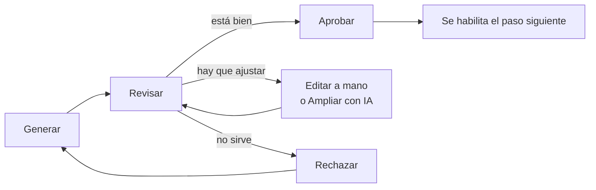

# Flujo de trabajo

Un proyecto avanza **paso a paso**. Cada paso produce un artefacto (por ejemplo, el diagrama de clases), y cada artefacto se genera a partir de los pasos anteriores **ya aprobados**. Así los diagramas son coherentes entre sí: el entidad-relación sale de las clases, el prototipo del entidad-relación y de los requerimientos, la arquitectura de todo lo anterior.

## Las acciones de cada paso

| Acción | Qué hace |
|---|---|
| **Generar** | La IA crea el artefacto con lo aprobado hasta ese momento |
| **Agregar indicaciones** | Antes de generar, permite pedir algo concreto para ese paso (ej. *"agrupa los casos de uso por módulo"*). Se guarda y se reutiliza al regenerar |
| **Regenerar** | Lo crea de nuevo. Pide confirmación, porque reemplaza la versión actual y los cambios hechos a mano |
| **Editar** | Cambiar el resultado a mano: los requerimientos uno por uno, el código de un diagrama, una pantalla del prototipo o un archivo de código |
| **Ampliar con IA** | Escribes qué agregar o cambiar y la IA ajusta el resultado actual **sin generarlo de cero** |
| **Aprobar** | Lo das por bueno. El paso queda **bloqueado** (para cambiarlo hay que pulsar **Editar**) y se habilita el siguiente |
| **Rechazar** | Lo descartas para ajustar las indicaciones y generarlo de nuevo. También se borra lo que dependía de él |
| **Eliminar** | Igual que rechazar, desde los controles del paso |

## Cambios en cascada

Si cambias un paso ya aprobado, los pasos que se generaron a partir de él quedan **Desactualizados** (etiqueta roja). Arriba aparece un aviso con dos opciones:

- **Actualizar todo**: regenera en orden los pasos desactualizados. Cada uno queda *pendiente de revisión*.
- **Conservar como está**: el cambio no les afecta. Recuperan su aprobación sin regenerarse.

Al aprobar un paso que cambió, la herramienta ofrece actualizar solo el siguiente, para revisarlos de a uno.

## Aprobación de fases

- La fase de **Análisis** se aprueba cuando sus pasos (requerimientos y casos de uso) están aprobados. Se pulsa **Continuar a Diseño**.
- La fase de **Diseño** se aprueba cuando sus seis pasos están aprobados. Se pulsa **Continuar a Implementación**. Con el Diseño aprobado también se habilita el **Informe**.

:::info Captura pendiente
`capturas/04-paso-aprobado.png`: un paso aprobado (barra "Aprobado" con el botón Editar) y otro desactualizado.
:::

## Qué modelo de IA respondió

Junto al título de cada paso, una etiqueta indica el modelo que lo generó (ej. *gemini-3.8-flash* o *claude-sonnet-5*). Ver [Componente de IA](../ia/funcionamiento).
